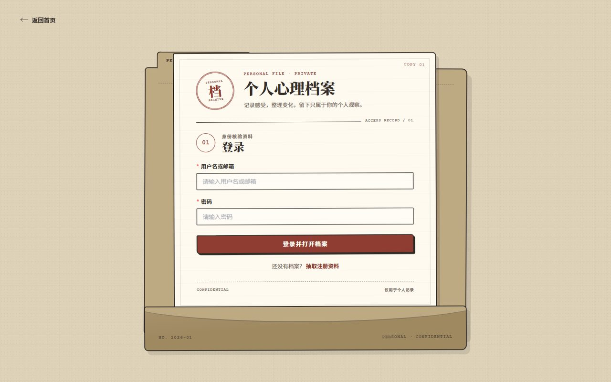
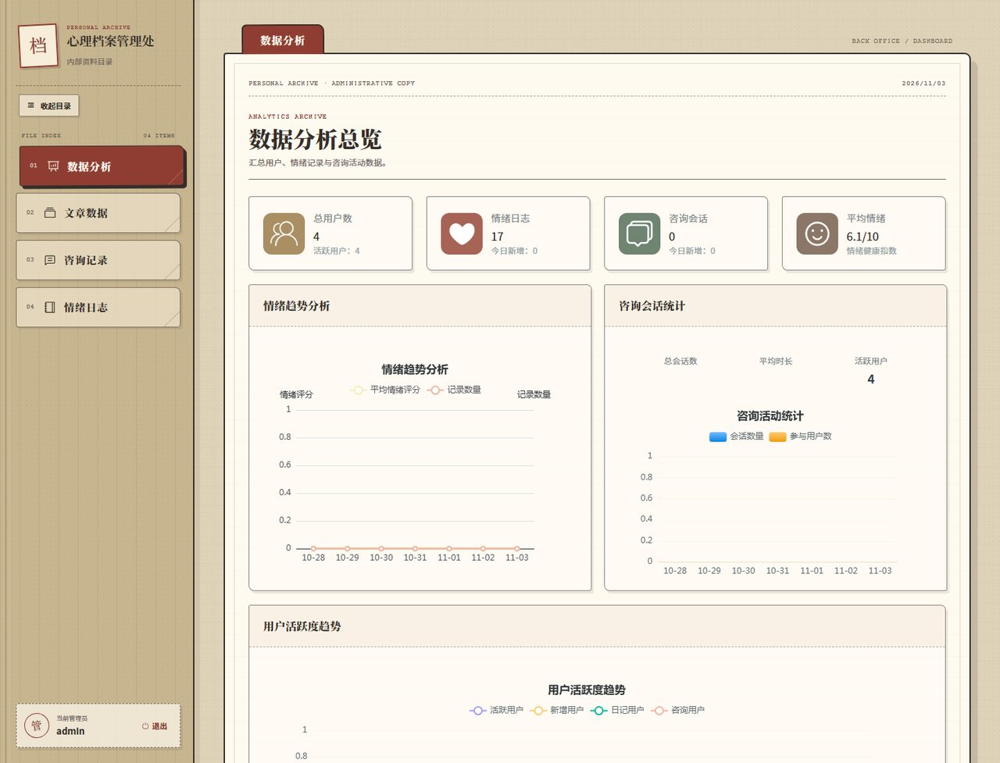
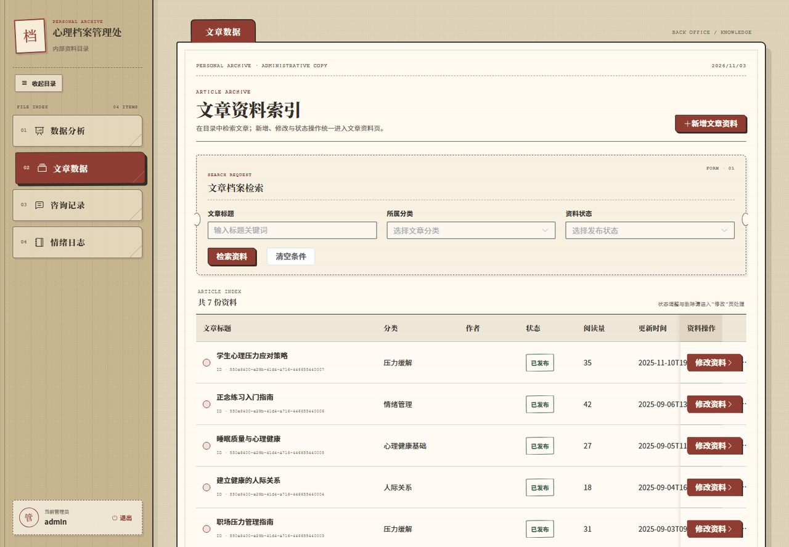

# 心理健康 AI 助手

面向大学生的心理健康 AI 咨询系统，包含 **Vue 3 前端** 与 **Spring Boot 后端**。提供 AI 流式对话、咨询记录、情绪日记、心理健康知识库与管理端数据看板。

## 技术栈

| 层 | 技术 |
| --- | --- |
| 前端 | Vue 3、Vite、Element Plus、Pinia、Vue Router、ECharts、markdown 渲染 |
| 后端 | Spring Boot 3.5、Spring AI 1.0（OpenAI 兼容协议）、MyBatis-Plus 3.5、MySQL 8 |
| 鉴权 | JWT（java-jwt）、Spring Security、BCrypt 密码存储 |
| 模型 | 硅基流动 DeepSeek-V3（`/v1/chat/completions`，SSE 流式） |

## 目录结构

```
mental-health-ai/
├─ backend/     Spring Boot 后端（Maven）
├─ frontend/    Vue 3 前端（Vite）
├─ sql/         会话与消息建表脚本
└─ docs/        系统截图
```

## 功能概览

**用户端**
- 浏览心理科普文章、查看分类
- 发起 AI 心理咨询（SSE 流式输出，逐字显示）
- 查看历史咨询会话与消息明细、删除会话
- 记录情绪日记（心情分数、睡眠、压力、诱因）
- 个人资料与登录状态

**管理端**
- 数据看板：总用户、情绪日志、咨询会话、平均情绪分，以及近 7 天情绪趋势、咨询活动、用户活跃度三张图表
- 文章管理：增删改查、发布 / 下线、分类筛选、封面上传
- 咨询记录：分页查看所有会话与消息
- 情绪日志：查看、删除用户日记

## 快速开始

### 1. 数据库

```sql
CREATE DATABASE IF NOT EXISTS mental_health_assistant DEFAULT CHARSET utf8mb4;
```

导入业务表（`user`、`knowledge_*`、`emotion_diary`、`sys_file_info` 等），并执行：

```bash
mysql -uroot -p mental_health_assistant < sql/consultation.sql
```

### 2. 后端

```bash
cd backend

# Windows
set AI_API_KEY=你的硅基流动 API Key
set DB_USERNAME=root
set DB_PASSWORD=你的数据库密码

mvnw.cmd spring-boot:run
```

监听 **http://localhost:1236**。

### 3. 前端

```bash
cd frontend
npm install
npm run dev
```

访问 **http://localhost:5174**（`/api` 已代理到本地 1236）。

## 演示账号

| 账号 | 密码 | 角色 | 登录后 |
| --- | --- | --- | --- |
| admin | 123456 | 管理员 | 管理后台看板 |
| test1 | 123456 | 管理员 | 管理后台看板 |
| test | 123456 | 普通用户 | 前台首页 |
| ces | 123456 | 普通用户 | 前台首页 |

## 系统截图

### 登录



### 管理端数据看板



### 知识库文章管理



## 主要接口

| 模块 | 接口 |
| --- | --- |
| 认证 | `POST /api/user/login`、`POST /api/user/add`、`GET /api/user/current`、`POST /api/user/logout` |
| 对话 | `POST /api/psychological-chat/session/start`、`POST /api/psychological-chat/stream`（SSE） |
| 咨询记录 | `GET /api/psychological-chat/sessions`、`GET /sessions/{id}/messages`、`DELETE /sessions/{id}` |
| 情绪日记 | `POST /api/emotion-diary`、`GET /api/emotion-diary/my`、`GET /api/emotion-diary/admin/page` |
| 知识库 | `GET /api/knowledge/article/page`、`GET /article/{id}`、`POST /article`、`PUT /article/{id}`、`PUT /article/{id}/status`、`DELETE /article/{id}`、`GET /category/tree` |
| 文件 | `POST /api/file/upload`（返回 `/uploads/...` 可直接访问） |
| 看板 | `GET /api/data-analytics/overview` |

## 没有 API Key / 余额不足时会发生什么

这是一个**依赖外部大模型**的项目，仓库里不包含任何 API Key。因此直接拉下来运行时，除「AI 回复」外的功能都是正常的。

### 可以正常使用的部分

- 登录 / 注册 / JWT 鉴权
- 文章浏览、分类筛选、文章详情
- **创建会话、消息落库、历史咨询记录、删除会话**
- 情绪日记的增删查
- 管理端看板（用户数、日记数、会话数、图表）
- 文件上传与封面显示

也就是说：即使没有 Key，也能完整演示「会话建立 → 消息入库 → 记录查询」这条链路，只是模型回复会被跳过。

### 只有「发送消息」这一步会失败

后端捕获模型服务异常后，不会抛 500，而是通过 SSE 的 `error` 事件返回中文提示，前端直接展示在聊天区域：

```text
event:error
data:{"code":"500","msg":"AI 服务账户余额不足，请到硅基流动控制台充值后重试"}
```

完整对照：

| 情况 | 返回提示 |
| --- | --- |
| 未配置 `AI_API_KEY` | AI 服务密钥无效，请检查环境变量 AI_API_KEY |
| Key 有效但余额为 0 | AI 服务账户余额不足，请到硅基流动控制台充值后重试 |
| 网络超时 | AI 服务响应超时，请稍后重试 |
| 其他 | AI 服务暂时不可用：<原始错误> |

### 怎么验证这条链路

```bash
# 1. 登录拿 token
curl -X POST http://localhost:1236/api/user/login \
  -H "Content-Type: application/json" \
  -d '{"username":"admin","password":"123456"}'

# 2. 创建会话（会写库）
curl -X POST http://localhost:1236/api/psychological-chat/session/start \
  -H "Authorization: Bearer <token>" -H "Content-Type: application/json" \
  -d '{"sessionTitle":"测试","initialMessage":"你好"}'

# 3. 发消息（无 Key 时返回上面那条 error 事件）
curl -N -X POST http://localhost:1236/api/psychological-chat/stream \
  -H "Authorization: Bearer <token>" -H "Content-Type: application/json" \
  -H "Accept: text/event-stream" \
  -d '{"sessionId":"session_1","userMessage":"最近压力大"}'
```

> 结论：**AI 回复不可用是模型额度问题，不是代码问题**。配置 `AI_API_KEY` 并充值后即可正常对话，无需改动任何代码。

## 设计要点

- **流式对话**：后端用 Spring AI 的 `ChatClient.stream()` + SSE 推送，前端用 `fetchEventSource` 逐块渲染；数据库读写与权限校验放在流式返回之前，避免在响应式回调里做阻塞操作。
- **会话记忆**：由 `MessageChatMemoryAdvisor` 统一维护，窗口保留最近 30 条，控制上下文长度与 token 成本。
- **越权防护**：会话、消息、情绪结果都校验 `session.userId == 当前用户`。
- **错误可读**：AI 调用失败时（如余额不足、密钥失效）通过 SSE `error` 事件返回中文提示，前端直接展示。
- **统一响应**：`Result{code,msg,data}` + 全局异常处理，参数校验、业务异常、兜底异常分开处理。

## 说明

- 支付、短信等能力未接入，属课程演示项目
- AI 能力依赖外部模型服务，需自备 API Key 与额度
- `application.yml` 中的密钥、密码均为占位默认值，实际部署请用环境变量覆盖
